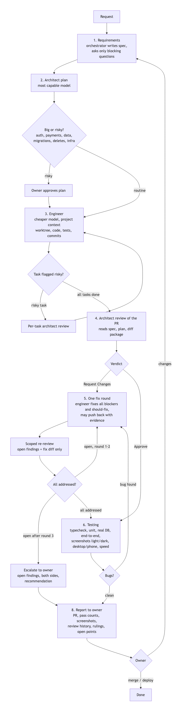
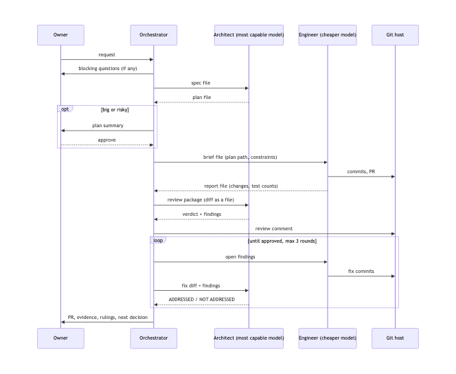

# Dev pipeline

A process for building features and fixes with AI agents: separate roles, an architect review loop, and evidence before anything is called done.

The agent skill is [SKILL.md](SKILL.md). Diagram sources are in [docs/diagrams/](docs/diagrams); after editing one, re-render the PNGs. Prompt templates are in [templates/](templates), helper scripts are in [scripts/](scripts), extra recipes in [references/](references), and [config.example.md](config.example.md) shows the local setup.

## Flow

Mermaid source

See [docs/diagrams/flow.mmd](docs/diagrams/flow.mmd).

## Who does what

Mermaid source

See [docs/diagrams/roles.mmd](docs/diagrams/roles.mmd).

## Why it's built this way

- **Separate roles catch more.** The engineer that wrote the code doesn't approve it. The architect reads the code, not the engineer's summary.
- **The strongest model where judgment matters, a cheaper one for volume.** Plans and reviews are short and high-stakes. Code and fixes are long and well specified.
- **Files, not chat.** Spec, plan, brief, diff package, and report are files. Each model reads exactly what it needs, and nothing grows the orchestrator's context.
- **One review per PR,** plus per-task reviews only for risky tasks. Re-reviews read only the fix diff.
- **Cap of 3 fix rounds.** Past that, the problem is structural and a person should decide.
- **Rulings are written down.** Any decision taken without the owner goes in the ledger as `Ruling: what — why — cost if wrong` and into the final report.
- **Evidence before claims.** No "done" without fresh command output: test counts, build exit codes, screenshots.

## Install

Copy this folder into your agent's skills directory, then create `config.local.md` from [config.example.md](config.example.md).

## Credits

Ideas adapted from [obra/superpowers](https://github.com/obra/superpowers) (MIT): the progress ledger, review packages as files, scoped re-reviews, the fix-round cap, the rulings log, and the rules for receiving review and verifying before claims.
